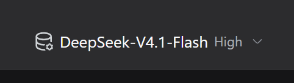
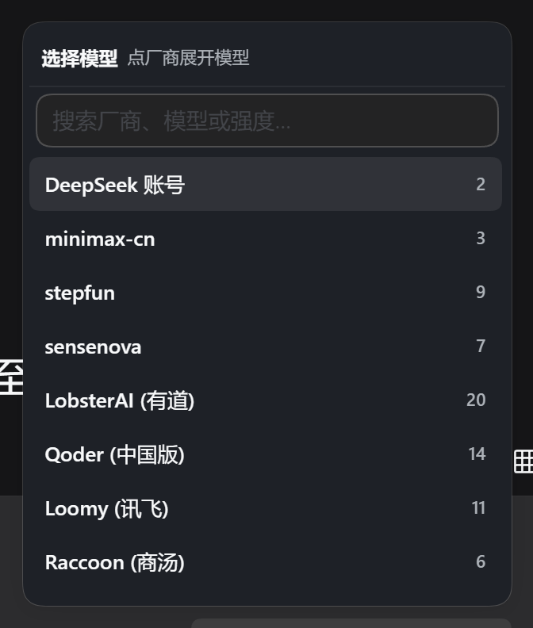
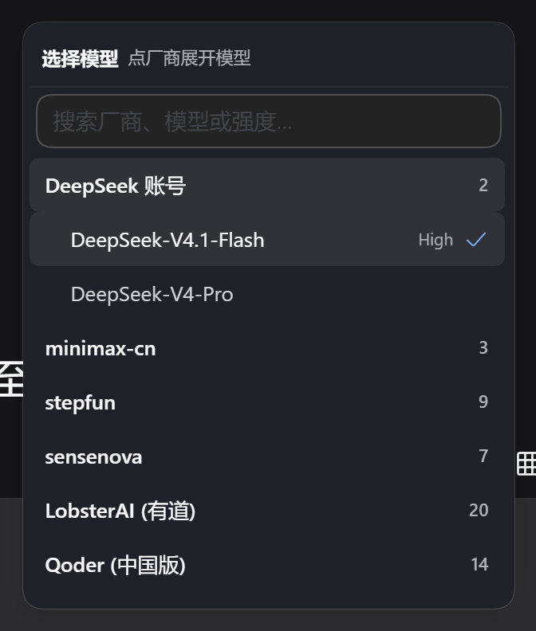
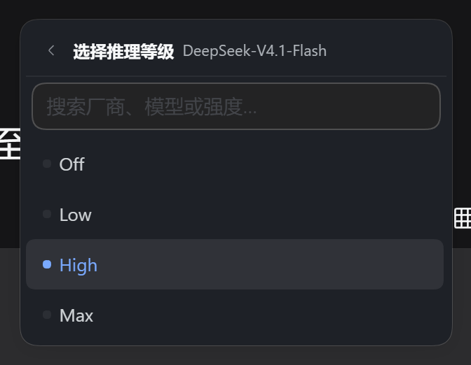
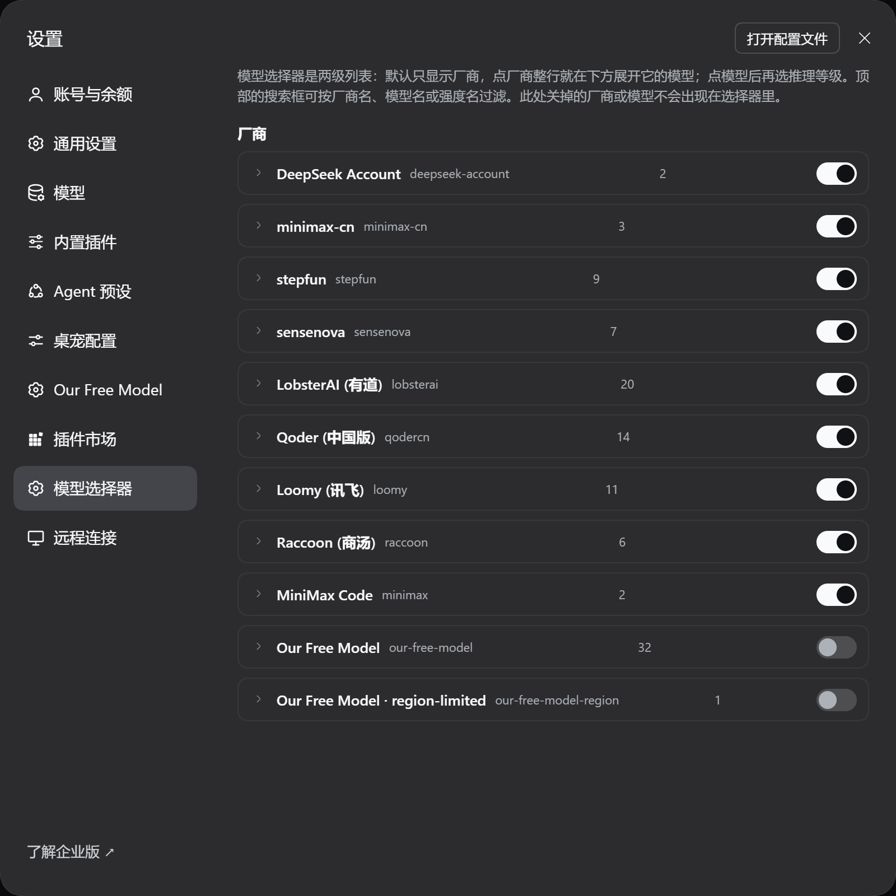

# dsh-model-provider-picker

为 [DeepSeek Harness](https://github.com/deepseek-ai/deepseek-harness) 提供**厂商优先**的模型选择器，以及一套**按厂商/模型隐藏**的可见性设置。

官方的模型选择器把所有厂商的模型平铺在一个列表里，按厂商分组显示标题。本插件把它改成两级结构：**先看厂商，点开展开该厂商的模型，选中模型后再选推理等级**；同时把「哪些厂商/模型不该出现」交给用户自己决定。

---

## 界面预览

| composer 的模型位 | 两级列表（默认只显示厂商） |
| --- | --- |
|  |  |

| 点厂商，在下方展开模型 | 选中模型后选推理等级 |
| --- | --- |
|  |  |

设置面板里的「模型选择器」分区：



> 截图取自真实运行环境。为便于阅读，截图会话里隐藏了桌宠贴纸、并把菜单的毛玻璃材质换成了实底（headless 环境渲染不出 `backdrop-filter`）。

---

## 功能

### 1. 两级模型列表

composer 的模型位显示 `模型名 推理等级`（等级用更小更淡的字体），点击后弹出选择器：

```
选择模型                    点厂商展开模型
────────────────────────────────────────
Raccoon                              4
MiniMax 国内                         2
SenseNova                            3
```

默认**只显示厂商**。点厂商整行，在它下方展开该厂商的模型：

```
Raccoon                              4
  DeepSeek-V4.1-Flash  开启   sn-...   ✓
  Kimi K3                     sn-kimi-k3
  MiniMax-M3                  sn-minimax-m3
  GLM-5.2                     sn-glm-5.2
```

### 2. 选中模型后再选推理等级

点一个有推理等级的模型，选择器切到第二屏：

```
←  选择推理等级        DeepSeek-V4.1-Flash
────────────────────────────────────────
●  关闭
●  开启
```

- 提供等级的模型 → 进这一屏选等级
- **不提供等级的模型** → 点一下直接选中，不弹第二屏

推理等级严格绑定到「厂商 + 模型」：同名模型（例如 `deepseek-chat` 同时出现在「DeepSeek 账号」和「开放平台」）各自保留自己的档位，互不串台。

### 3. 搜索

选择器顶部的搜索框支持三类关键词：

| 搜索 | 行为 |
| --- | --- |
| 模型名 / 模型 id | 列出命中的模型，并保留其厂商 |
| 厂商名 | 展开该厂商的**全部**模型 |
| 推理等级名（如 `max`） | 列出提供该等级的模型 |

搜索期间厂商自动展开，折叠状态被忽略。

### 4. 可见性设置

设置面板里新增一个 **「模型选择器」** 分区：

- 每个厂商一个主开关 —— 关掉后该厂商及其全部模型都不出现在选择器里
- 展开厂商后，每个模型一个独立开关 —— 可以只藏掉某一个模型
- 每个模型旁边标注「N 档强度」，隐藏前就能看到它有没有推理等级

规则立即写回 Host，选择器实时同步。

---

## 安装

本插件是一个 DSH **profile 插件**（Host 半身 + Client 半身），通过 profile 的 `package.json` 与 `cordis.patch.yml` 挂载。

### 方式一：直接引用本地目录（开发用）

在 DSH 的 profile 目录（通常是 `<DSH_HOME>/profiles/web`）执行：

```bash
pnpm add link:/path/to/dsh-model-provider-picker
```

然后把包名加进 `package.json` 的 `dsh.profile.bundles`：

```json
{
  "dsh": {
    "profile": {
      "bundles": [
        "@deepseek-ai/dsh-base",
        "@deepseek-ai/dsh-web-app",
        "dsh-model-provider-picker"
      ]
    }
  }
}
```

`link:` 会建立 junction/符号链接，改源码后重启 Harness 即可生效，不必重新安装。

### 方式二：打包安装

```bash
pnpm pack
pnpm add file:/path/to/dsh-model-provider-picker-1.0.0.tgz
```

### 激活

重启 Harness（关闭并重新打开 DSH Desktop，或重启 `dsh web` 进程）。
插件列表里出现 `dsh-model-provider-picker` 即为加载成功；设置面板里会出现「模型选择器」分区。

> Client 半身是 `window.__ModuleLoader__.load(...)` 形式的 bundle，改代码后需要**重启宿主进程**并**刷新页面**才能拿到新 bundle —— 桌面版的 HMR 只监听配置层，不做模块热替换。

---

## 数据存储

隐藏规则存在 Host 设置文档的 `model-provider-picker` 命名空间下，由 `lib/index.js` 的 volatile Config 声明：

```yaml
model-provider-picker:
  hiddenProviders: [raccoon]                    # 整厂商隐藏
  hiddenModels: [raccoon/sn-glm-5.2]            # 单模型隐藏（provider/model）
```

两组都是字符串数组，因此能被 DSH 的 settings 表单安全投影、编辑与持久化。厂商被整体隐藏后，它下面的模型规则自然失效。

---

## 开发

```bash
npm test        # 跑规则引擎 + 原型的逻辑测试
```

也可以直接用浏览器打开 [`prototype/index.html`](prototype/index.html) 看交互原型 —— 它和 `lib/client.js` 里的实现共用同一套规则语义，是调 UI 时最快的反馈回路。

### 重新生成界面截图

README 里的截图由 [`docs/screenshot.mjs`](docs/screenshot.mjs) 驱动真实 GUI 生成（playwright-core + 系统 Edge，不下载额外浏览器）：

```bash
npm i -D playwright-core
node docs/screenshot.mjs
```

脚本会从 Harness 日志里读当前启动的 GUI 地址，登录后依次操作：点模型位 → 展开厂商 → 打开推理等级屏 → 打开设置面板，输出到 `docs/screenshots/`。它会在截图会话里临时隐藏桌宠、并把菜单换成实底，避免遮挡和 headless 下的毛玻璃失真。

### 目录结构

```
├── lib/
│   ├── index.js          # Host 半身：声明可见性 Config 命名空间
│   └── client.js         # Client 半身：选择器 + 设置页（手写 ModuleLoader bundle）
├── prototype/
│   └── index.html        # 可交互原型（纯前端，无需 DSH）
├── test/
│   ├── visibility.test.mjs   # 可见性规则引擎
│   └── prototype.test.mjs    # 原型交互逻辑
├── docs/
│   ├── screenshot.mjs        # 驱动真实 GUI 生成截图
│   └── screenshots/          # README 引用的界面图
├── cordis.patch.yml      # 把 Host 半身插进 profile 的 loader
└── package.json
```

### 实现要点

**Client 半身没有构建步骤。** 它是一份手写的 `window.__ModuleLoader__.load({ id, factory })` bundle，只 `require` 平台已经提供的静态模块（`react`、`@deepseek-ai/dsh-client-store`、`@deepseek-ai/dsh-client-ui-primitives`）。改代码无需打包，重启宿主即可。

**遮蔽 composer 的模型位。** 官方 `@deepseek-ai/dsh-client-ui-model-selection` 把模型位注册在 `conversation.input.model` 这个 `single` slot 上（priority `0`）。本插件注册同一个 slot 但 priority 为 `-10`——DSH 的 slot 按 priority 升序取第一个存活条目，因此本插件排前面并遮蔽官方实现。官方的注册仍留在 ledger 上，它声明的子 slot `conversation.input.model.label` 因此继续可用。

**复用官方的会话目录。** 目录与提交都走官方插件提供的 `modelDirectories` 服务（`directoryFor(sessionId)` → `store` / `load()` / `select()`），所以本插件的选择器与官方 `/model` 命令读到的是同一份事实，唯一区别是多了一层可见性过滤。服务缺席时选择器那一段保持等待，不会拖垮整个插件。

**注入的两个坑。** DSH 的 slot `inject` 只有在 **`hooks` 字段内**的 observable 才会被渲染层转成 `use<Name>` 选择器 Hook；平铺返回的 observable 只是普通 prop，组件拿不到订阅。另外 Hook 必须无条件调用，因此代码里用 `useEmptyRules` / `useEmptyCatalog` 兜底，而不是在调用点做条件判断。

---

## 已知限制

- **只影响 Web / 桌面 GUI。** 纯 Host 侧的模型路由不受影响；被隐藏的模型仍可通过直接构造请求使用。
- **依赖官方 model-selection 插件。** 若上游移除 `conversation.input.model` slot 或 `modelDirectories` 服务，本插件的选择器会等待而不再渲染（设置页仍可用）。
- **不做键盘导航。** 当前支持鼠标点击、搜索与 Esc 关闭；官方实现里的 `↑`/`↓` 循环、Tab 焦点移交等尚未移植。
- **规则是这台机器上的偏好。** 存在 Host 设置文档里，随 profile 走，不跨设备同步。

---

## 许可证

[MIT](LICENSE)
