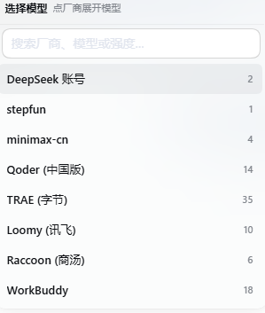
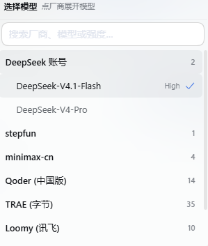
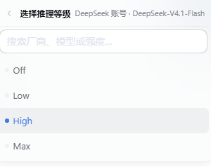
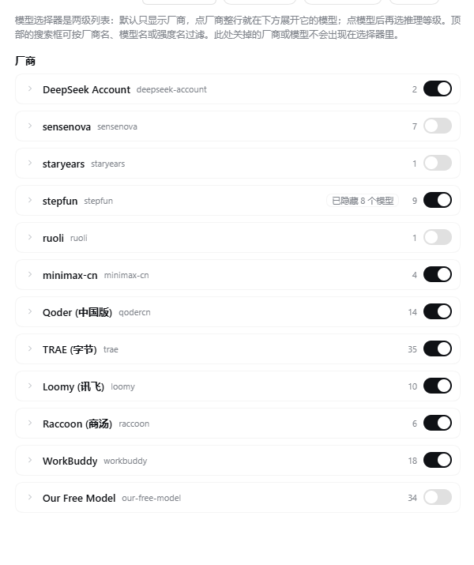

# dsh-model-provider-picker

为 [DeepSeek Harness](https://github.com/deepseek-ai/deepseek-harness) 提供**厂商优先**的模型选择器、**按厂商/模型隐藏**的可见性设置，以及一套**厂商预设库**（一键添加常见厂商的模型配置）。

官方的模型选择器把所有厂商的模型平铺在一个列表里，按厂商分组显示标题。本插件把它改成两级结构：**先看厂商，点开展开该厂商的模型，选中模型后再选推理等级**；同时把「哪些厂商/模型不该出现」交给用户自己决定，并提供不离开设置页就能完成的厂商增删改。

---

## 界面预览

| composer 的模型位 | 两级列表（默认只显示厂商） |
| --- | --- |
|  |  |

| 点厂商，在下方展开模型 | 选中模型后选推理等级 |
| --- | --- |
|  |  |

设置面板里的「模型选择器」分区：



> 截图取自真实运行环境。为便于阅读，截图会话里隐藏了桌宠贴纸、并把菜单的毛玻璃材质换成了实底（headless 环境渲染不出 `backdrop-filter`）。

---

## 功能

### 1. 两级模型列表

composer 的模型位显示 `厂商 · 模型名`（等级用更小更淡的字体），点击后弹出选择器：

```
选择模型                    点厂商展开模型
────────────────────────────────────────
Raccoon                              4
MiniMax 国内                         2
SenseNova                            3
```

默认**只显示厂商**。点厂商整行，在它下方展开该厂商的模型：

```
Raccoon                              4
  DeepSeek-V4.1-Flash  开启   sn-...   ✓
  Kimi K3                     sn-kimi-k3
  MiniMax-M3                  sn-minimax-m3
  GLM-5.2                     sn-glm-5.2
```

### 2. 选中模型后再选推理等级

点一个有推理等级的模型，选择器切到第二屏：

```
←  选择推理等级        DeepSeek-V4.1-Flash
────────────────────────────────────────
●  关闭
●  开启
```

- 提供等级的模型 → 进这一屏选等级
- **不提供等级的模型** → 点一下直接选中，不弹第二屏

推理等级严格绑定到「厂商 + 模型」：同名模型（例如 `deepseek-chat` 同时出现在「DeepSeek 账号」和「开放平台」）各自保留自己的档位，互不串台。

### 3. 搜索

选择器顶部的搜索框支持三类关键词：

| 搜索 | 行为 |
| --- | --- |
| 模型名 / 模型 id | 列出命中的模型，并保留其厂商 |
| 厂商名 | 展开该厂商的**全部**模型 |
| 推理等级名（如 `max`） | 列出提供该等级的模型 |

搜索期间厂商自动展开，折叠状态被忽略。

### 4. 可见性设置

设置面板里的 **「模型选择器」** 分区：

- 每个厂商一个主开关 —— 关掉后该厂商及其全部模型都不出现在选择器里
- 展开厂商后，每个模型一个独立开关 —— 可以只藏掉某一个模型
- 每个模型旁边标注「N 档强度」，隐藏前就能看到它有没有推理等级
- 「已隐藏 N 个模型」**只统计当前目录里仍然存在的模型**；指向已删除模型的失效规则不计入，并在标题旁提供「清理 N 条失效规则」按钮

规则立即写回 Host，选择器实时同步。

### 5. 厂商预设库（一键添加）

设置页顶部提供 **「+ 添加厂商」**，内置 15 个常见厂商预设，选中后表单已预填，填个 API Key 即可创建：

| 分类 | 预设 |
| --- | --- |
| 国内官方 | Sensenova 商汤、讯飞星火 MaaS、阶跃星辰 StepFun、MiniMax、月之暗面 Kimi、智谱 GLM、DeepSeek 官方、阿里云百炼、火山方舟、硅基流动 |
| 海外/聚合 | OpenAI、Anthropic、Google Gemini、OpenRouter、Groq |

另有固定入口 **「自定义 API」**（虚线卡片），空表单起填，可接任何 OpenAI 兼容 / Responses / Anthropic Messages 端点。

**创建流程**

1. 选预设 → 表单预填（路由 ID、显示名、Base URL、协议、模型清单全部可改）
2. 填 API Key（若凭证库已有该厂商的 Key，会提示可直接留空）
3. 可点「从 API 拉取」用该端点实时拉取真实模型清单
4. 创建 → 写凭证 + 写配置 → **选择器、设置页、官方「模型」页三方立即同步**

**写入通道**与官方模型设置页完全一致：`remote.settings.mutate("llm-pi-ai", ...)` 写配置、`remote.credentials.set("<ROUTE>_API_KEY", ...)` 写凭证。密钥进凭证库，**不明文进配置文件**。

**模型清单**每行三列：模型 ID、模型名称、上下文窗口。名称默认与 ID 一致——从 API 拉取时优先用端点返回的名称，也可手填覆盖。

### 6. 编辑与删除已添加厂商

- 已添加的厂商显示「编辑」按钮 + 垃圾桶图标
- **编辑**：从现有 profile 预填（路由 ID 锁定），提交时以既有 profile 为底**合并**——表单管不到的字段（模型的 `input` 模态、`maxTokens`、自定义 `name`）原样保留
- **删除**：垃圾桶双确认，先清凭证再 unset 配置；两步幂等可重试
- 徽章区分「已添加」（llm-pi-ai 中可定位，可编辑删除）与「已注册」（其他命名空间声明，仅提示占用）

### 7. API Key 显隐

Key 输入框右侧有眼睛按钮，可在**明文与圆点**之间切换。若开启了「凭证回显」（见下节），编辑已有厂商时会自动预填该厂商本地已存的 Key。

---

## 凭证回显（默认关闭，请先读安全说明）

DSH 的凭证接口是**只写**的——`credentials/set` 的官方描述明确写着 *"The value crosses the wire in this direction only: no read path returns it"*，官方设置页也因此永远只显示「已配置」状态，不回显明文。

本插件提供一个 **opt-in** 的回显开关（设置页底部「凭证回显」，**默认关闭**）：

1. 关闭时：编辑厂商不预填 Key，Host 半身不读取任何明文，投影里的映射恒为空
2. 开启时：`lib/index.js` 读取 `~/.dsh/.credentials.yaml` 的 `refs:` 段与 `*_API_KEY` 环境变量，写入 `revealedKeys` 字段，并监听凭证文件变化实时刷新（400ms 防抖）
3. Client 半身编辑厂商时按该厂商的 `apiKeyEnv` 预填输入框
4. 关闭开关立即把映射写回空，清除明文

**⚠️ 安全说明（务必阅读）**

- **开启期间明文会落盘**：settings 通道（包括 volatile 字段）会持久化到 profile 的 `cordis.patch.yml`。这是该功能的已知代价——**核对完请关闭开关**
- 这是**绕过宿主刻意设置的安全边界**；投影里的明文对同会话的其他 client 插件也可见
- 只对**本地文件或环境变量里的 `*_API_KEY`** 有效；OAuth 类记录（`*_ACCOUNT_*` 的 JSON token）不回显
- **不要把开启状态的配置分发出去**；分享/提交仓库前确认 `revealedKeys` 为空
- Host 侧若未来收紧 volatile 字段投影，此功能会静默降级（不影响其他功能）

不需要此功能的话，删掉 `lib/index.js` 中 `readRevealedKeys` / `parseRevealedKeys` 相关代码与 `revealKeysEnabled`、`revealedKeys` 两个字段即可，其余功能不受影响。

---

## 安装

本插件是一个 DSH **profile 插件**（Host 半身 + Client 半身），通过 profile 的 `package.json` 与 `cordis.patch.yml` 挂载。

### 方式一：直接引用本地目录（开发用）

在 DSH 的 profile 目录（通常是 `<DSH_HOME>/profiles/web`）执行：

```bash
pnpm add link:/path/to/dsh-model-provider-picker
```

然后把包名加进 `package.json` 的 `dsh.profile.bundles`：

```json
{
  "dsh": {
    "profile": {
      "bundles": [
        "@deepseek-ai/dsh-base",
        "@deepseek-ai/dsh-web-app",
        "dsh-model-provider-picker"
      ]
    }
  }
}
```

`link:` 会建立 junction/符号链接，改源码后重启 Harness 即可生效，不必重新安装。

### 方式二：打包安装

```bash
pnpm pack
pnpm add file:/path/to/dsh-model-provider-picker-1.0.0.tgz
```

### 激活

重启 Harness（关闭并重新打开 DSH Desktop，或重启 `dsh web` 进程）。
插件列表里出现 `dsh-model-provider-picker` 即为加载成功；设置面板里会出现「模型选择器」分区。

> Client 半身是 `window.__ModuleLoader__.load(...)` 形式的 bundle，改代码后需要**重启宿主进程**并**刷新页面**才能拿到新 bundle —— 桌面版的 HMR 只监听配置层，不做模块热替换。
>
> 其中 **Host 半身（`lib/index.js`）的改动必须重启进程**，仅刷新页面无效。

---

## 数据存储

### 隐藏规则

存在 Host 设置文档的 `model-provider-picker` 命名空间下：

```yaml
model-provider-picker:
  hiddenProviders: [raccoon]                    # 整厂商隐藏
  hiddenModels: [raccoon/sn-glm-5.2]            # 单模型隐藏（provider/model）
  revealKeysEnabled: false                      # 凭证回显开关（默认关闭）
  revealedKeys: {}                              # 回显期间的明文映射（关闭即清空）
```

两组规则都是字符串数组，因此能被 DSH 的 settings 表单安全投影、编辑与持久化。厂商被整体隐藏后，它下面的模型规则自然失效。

> 注意：本命名空间的字段（含 volatile 标记）都会落盘到 profile 的 `cordis.patch.yml`。`revealedKeys` 只在回显开启期间含有明文，关闭开关即被写回空映射。

### 厂商配置与凭证

预设库**不新增存储位置**，全部写进官方已有的位置：

- 厂商配置 → `llm-pi-ai` 命名空间的 `providers.<route>`（与官方「模型」设置页同一份）
- API Key → 凭证库的 `<ROUTE>_API_KEY` 引用（`<ROUTE>` 由路由名推导，如 `minimax-cn` → `MINIMAX_CN_API_KEY`）

因此官方「模型」设置页与本插件的预设库可以混用，两边看到的是同一份事实。

---

## 目录结构

```
├── lib/
│   ├── index.js          # Host 半身：可见性 Config + opt-in 凭证回显 + 文件监听
│   └── client.js         # Client 半身：选择器 + 设置页 + 预设库（手写 ModuleLoader bundle）
├── prototype/
│   └── index.html        # 可交互原型（纯前端，无需 DSH）
├── test/
│   ├── visibility.test.mjs   # 可见性规则引擎
│   ├── prototype.test.mjs    # 原型交互逻辑
│   └── presets.test.mjs      # 预设库 / 提交归一化 / 编辑合并 / 回显解析
├── docs/
│   ├── market-entry/         # 插件市场收录的条目模板
│   ├── screenshot.mjs        # 驱动真实 GUI 生成截图
│   └── screenshots/          # README 引用的界面图
├── cordis.patch.yml      # 把 Host 半身插进 profile 的 loader
├── screenshots.json      # 市场收录的截图清单
├── package.json
└── README.md
```

---

## 开发

```bash
npm test        # 可见性规则 + 原型逻辑 + 预设库/回显（三套，全部不依赖浏览器）
```

也可以直接用浏览器打开 [`prototype/index.html`](prototype/index.html) 看交互原型 —— 它和 `lib/client.js` 里的实现共用同一套规则语义，是调 UI 时最快的反馈回路。

### 重新生成界面截图

README 里的截图由 [`docs/screenshot.mjs`](docs/screenshot.mjs) 驱动真实 GUI 生成（playwright-core + 系统 Edge，不下载额外浏览器）：

```bash
npm i -D playwright-core
node docs/screenshot.mjs
```

> 当前截图尚未包含「厂商预设库」与「凭证回显」两块新界面，欢迎重截后提 PR。

### 本地开发挂载

把本仓库以 junction 挂到 profile 的插件目录，改一处即生效：

```powershell
# Windows：先备份原目录，再建 junction
New-Item -ItemType Junction -Path "<DSH_HOME>\profiles\desktop\node_modules\dsh-model-provider-picker" -Target "E:\github\dsh-model-provider-picker"
```

---

## 实现要点

**Client 半身没有构建步骤。** 它是一份手写的 `window.__ModuleLoader__.load({ id, factory })` bundle，只 `require` 平台已经提供的静态模块（`react`、`@deepseek-ai/dsh-client-store`、`@deepseek-ai/dsh-client-ui-primitives`）。改代码无需打包，重启宿主即可。

**遮蔽 composer 的模型位。** 官方 `@deepseek-ai/dsh-client-ui-model-selection` 把模型位注册在 `conversation.input.model` 这个 `single` slot 上（priority `0`）。本插件注册同一个 slot 但 priority 为 `-10`——DSH 的 slot 按 priority 升序取第一个存活条目，因此本插件排前面并遮蔽官方实现。官方的注册仍留在 ledger 上，它声明的子 slot `conversation.input.model.label` 因此继续可用。

**复用官方的会话目录。** 目录与提交都走官方插件提供的 `modelDirectories` 服务（`directoryFor(sessionId)` → `store` / `load()` / `select()`），所以本插件的选择器与官方 `/model` 命令读到的是同一份事实，唯一区别是多了一层可见性过滤。服务缺席时选择器那一段保持等待，不会拖垮整个插件。

**菜单定位的自校正。** composer 的祖先元素可能带 `container-type` / `transform` / `backdrop-filter`，会把 `position: fixed` 的包含块从视口挪走，导致菜单坐标被解释到别处。弹窗放置逻辑先摆到目标坐标、实测落点、把差值补回，循环两三次即可精确贴靠；展开方向为「优先下方、放不下再翻到上方」，并监听 `ResizeObserver` 应对内容高度变化。

**预设库的写入通道。** 全部复用官方 Remote 接口，不直接改文件：`remote.llm.listProviders` / `listConfigurableProviders`（目录）、`remote.credentials.describe` / `set` / `unset`（凭证）、`remote.settings.mutate("llm-pi-ai", ...)`（厂商配置）、`remote.llm.discoverModels`（拉取模型清单）。因此宿主始终是唯一事实源，写入后无需重启即生效。

**发现模型时自动复用已存凭证。** 调用 `discoverModels` 时，若路由已存在，请求里带上 `provider: <route>`；适配器在请求未携带 `apiKey` 时会自动解析该路由已存的凭证来发请求——所以编辑厂商时 Key 留空也能正常拉取清单。

**编辑时的字段保全。** 提交编辑以既有 profile 为底合并，只覆盖表单可见的字段（`displayName` / `api` / `baseURL` / `models`），模型条目按 id 与旧值合并保留未知字段，避免把 `input`、`maxTokens` 等表单管不到的信息抹掉。

**注入的两个坑。** DSH 的 slot `inject` 只有在 **`hooks` 字段内**的 observable 才会被渲染层转成 `use<Name>` 选择器 Hook；平铺返回的 observable 只是普通 prop，组件拿不到订阅。另外 Hook 必须无条件调用，因此代码里用 `useEmptyRules` / `useEmptyCatalog` 兜底，而不是在调用点做条件判断。

---

## 已知限制

- **只影响 Web / 桌面 GUI。** 纯 Host 侧的模型路由不受影响；被隐藏的模型仍可通过直接构造请求使用。
- **依赖官方 model-selection 插件。** 若上游移除 `conversation.input.model` slot 或 `modelDirectories` 服务，本插件的选择器会等待而不再渲染（设置页仍可用）。
- **依赖官方 Remote 接口。** 预设库依赖 `llm-pi-ai` 命名空间与 `llm/credentials/settings` 三个 Remote 服务；上游改签名会导致预设库不可用（选择器与可见性设置不受影响）。
- **不做键盘导航。** 当前支持鼠标点击、搜索与 Esc 关闭；官方实现里的 `↑`/`↓` 循环、Tab 焦点移交等尚未移植。
- **规则是这台机器上的偏好。** 存在 Host 设置文档里，随 profile 走，不跨设备同步。
- **凭证回显默认关闭，开启期间明文落盘。** 它绕过宿主的只写设计，代价见「凭证回显」章节；提交或分享配置前确认 `revealedKeys` 为空。
- **预设清单是静态的。** 内置模型列表可能滞后于厂商更新，用「从 API 拉取」获取实时清单。

---

## 许可证

[MIT](LICENSE)
